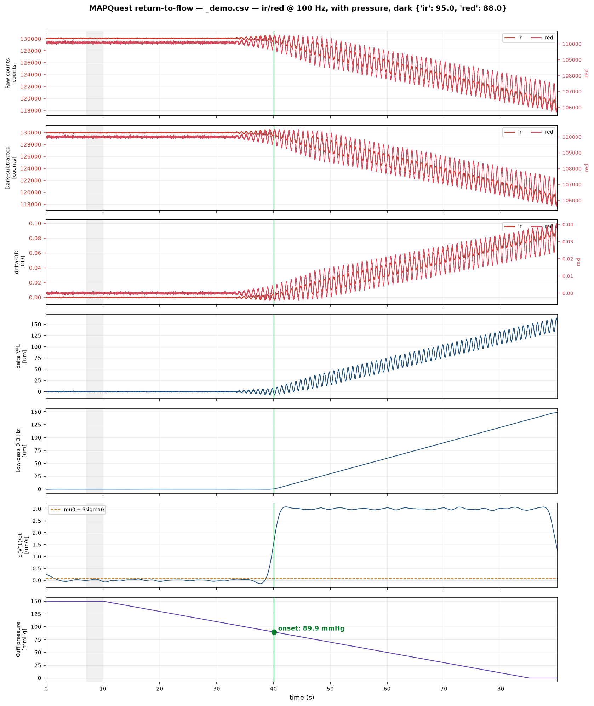

> **Fork additions for XIAO ESP32-S3:** This fork provides [two separate XIAO versions](xiao/README.md) plus a [passive PPG/pressure acquisition kit and build guide](research/PPG_Occlusion_Research_Kit/README.md).
>
> - **With reference MAP:** `xiao/MAX30101_Guided_MAP` retains the supplied guided calibration/model workflow and continuous plot commands. Requires external reference MAP inputs; predictions are research outputs, not validated clinical MAP.
> - **Without reference MAP:** `xiao/MAX30101_NoReference` guides optical baseline capture and reports relative, dimensionless changes. It does not estimate absolute MAP or output pressure in mmHg.
> - **Pressure/occlusion research:** `research/PPG_Occlusion_Research_Kit` records measured pneumatic pressure and raw PPG with markers. Pressure at a flow marker is not automatically MAP. No automatic occlusion or MAP estimator is included.
>
> Open [MAPQuest_XIAO.code-workspace](MAPQuest_XIAO.code-workspace) in VS Code, then select the desired project in PlatformIO. The upstream Nano ESP32/HX710B firmware and host pipeline remain separately available. Protocols and wiring differ; do not interchange their host tools.
>
> **Source independence:** The new implementations are unchanged copies of our earlier code and the user-supplied sketch. They do not reuse your teammate's implementation. The original project remains separately below and in fork history.
>
> See [integration and validation notes](docs/xiao-integration.md). No hardware or clinical validation is claimed by these additions.

# MAPQuest

Return-to-flow blood pressure prototype. An upper-arm cuff is bled down while a MAX30101 watches
the forearm; when cuff pressure drops below arterial pressure, blood flows in and cannot drain, the
forearm fills, and reflected light falls. **The research hypothesis associates cuff pressure at sustained-filling onset with arterial pressure; its relationship to MAP has not been established by patient validation.**

Full requirements: [`docs/SPEC.md`](docs/SPEC.md). Channel choice: [`docs/led-selection-report.md`](docs/led-selection-report.md).



*Synthetic recording, ground-truth MAP 90 mmHg, recovered at 89.9 mmHg.*

## Status

| Milestone | State |
|---|---|
| M0 Toolchain | firmware compiles for `arduino:esp32:nano_nora` |
| M1 PPG streaming | code complete; **run `bench_check.py` to close it out** |
| M2 Pressure | code written behind `PRESSURE_ENABLED`; **HX710B not yet owned** |
| M3 Logger | complete; pressure path untested |
| M4 Analysis | complete, validated against synthetic ground truth |
| M5 Tests | **37/37 passing** — SPEC §6 analysis criteria + protocol/mock-firmware |
| M6 Bench trials | not started |

Nothing here has touched real hardware yet. The analysis numbers come from synthetic data, and the
serial protocol is validated against a mock firmware (`tests/test_protocol.py`) rather than the
board. `bench_check.py` is the bridge: it runs the SPEC §3.5 acceptance criteria on real hardware.

## Hardware

| | |
|---|---|
| MCU | Arduino Nano ESP32 (ESP32-S3) |
| PPG | SparkFun SEN-16474 — MAX30101 Qwiic breakout |
| Pressure | MPS20N0040D + HX710B *(not yet fitted)* |

### Wiring (SPEC 2.2)

| Nano ESP32 | MAX30101 | | Nano ESP32 | HX710B |
|---|---|---|---|---|
| `3V3` | `3V3` | | `3V3` | `VCC` |
| `GND` | `GND` | | `GND` | `GND` |
| `A4` | `SDA` | | `D3` | `OUT` |
| `A5` | `SCL` | | `D2` | `SCK` |

3.3 V logic throughout — **do not power the HX710B from 5 V**, it would drive 5 V into an ESP32
GPIO. Calibrate at 3.3 V and don't reuse constants measured at 5 V.

## Quick start

### 1. Flash

Open `firmware/mapquest_ppg/mapquest_ppg.ino` in Arduino IDE 2.x, select **Arduino Nano ESP32**,
upload. **No libraries to install** — the MAX30101 driver is inline.

At 115200 baud you should see a `#` metadata block then:

```
# ready — send START to stream, INFO for settings
```

### 2. Python

```bash
pip install -r host/requirements.txt
```

### 3. Verify the analysis without hardware

```bash
cd host
python synth.py --map 90 --out ../data/s90.csv
python analyze.py ../data/s90.csv
```

Should report onset within ±1 mmHg of 90. Then run the acceptance suite:

```bash
python -m pytest tests/ -v
```

### 4. Check the hardware

With the Nano and MAX30101 wired and flashed — no cuff or pressure sensor needed:

```bash
cd host
python bench_check.py --auto-tune --plot
```

This runs the SPEC §3.5 acceptance criteria as pass/fail: sensor found at 0x57, DARK offsets
≤128 counts, IR DC inside 105k–157k, output rate within 1% of 100 Hz, and zero dropped samples.
`--auto-tune` sets the LED currents for you; `--full` runs the 5-minute drop test that is the real
M1 gate. `--save` keeps the samples as CSV **and** the console report as `.log.txt`, with the
auto-tune DC-versus-current trajectory in the CSV header.

### 4b. Confirm the sensor sees blood

SPEC 3.5 can pass with the photodiode staring at a wall, so there is a separate
test for whether light actually reaches perfused tissue:

```bash
cd host && python bench_check.py --provocation --site wrist --plot --save
```

It cues you through raise / rest / lower cycles and reports whether IR DC moves
reversibly with arm position. Raising the arm drains venous blood, so counts should
**rise**; lowering it should drop them.

This is a better gate than hunting for a heartbeat: the measurement detects slow venous
filling, which is roughly 10x larger than the cardiac AC, so a site can be perfectly
viable while showing no resolvable pulse. The protocol rests before and after each
manoeuvre, so baseline drift cancels rather than faking a response.

### 5. Record

```bash
cd host
python logger.py --calibrate                      # once, when the HX710B is fitted
python logger.py --subject T01 --trial 1 --note "left arm, seated"
python analyze.py ../data/<date>_T01_1.csv
```

The logger sends `INFO`, then `DARK`, then `START`, and writes a self-describing CSV. Ctrl-C sends
`STOP` and closes cleanly.

## Layout

```
firmware/mapquest_ppg/
  mapquest_ppg.ino     self-contained MAX30101 driver + SPEC 3.4 protocol
  config.h             all tunables; echoed into every recording header
host/
  mapquest/
    io.py              serial protocol, metadata parsing, CSV load, calibration
    pipeline.py        raw -> dOD -> dV*L -> low-pass -> dV/dt -> onset
  bench_check.py       SPEC 3.5 hardware acceptance checks, LED auto-tune
  provocation.py       arm-raise blood-volume response test
  logger.py            recording + two-point pressure calibration
  analyze.py           offline analysis, figure, results.csv row
  synth.py             synthetic recordings with known ground truth
tests/
  test_pipeline.py     SPEC section 6 analysis acceptance tests
  test_protocol.py     serial protocol against a mock firmware
  test_provocation.py  arm-raise response analysis
data/                  recordings (gitignored)
docs/
  SPEC.md              the requirements
  decisions.md         decision log — every deviation and why
  architecture.md      system + pipeline diagrams, living status
  led-selection-report.md  why Red + IR, with sources
```

## Configuration

Red + IR in SpO2 mode, 411 µs pulse width (18-bit), 400 sps internal with 4× hardware averaging →
**100 Hz output per channel**. Everything tunable is in `firmware/mapquest_ppg/config.h`.

Green is deliberately unused — the two-wavelength Beer–Lambert solve needs the 660/880 nm pair, and
green's 0.3–0.8 mm penetration would miss the forearm filling anyway. See the LED report.

## Decisions

Every non-obvious choice is recorded in [`docs/decisions.md`](docs/decisions.md), including the
four places this build deviates from `SPEC.md` (onset method, measurement site, and two
protocol additions) and the three open questions that gate whether the measurement
works at all.

## Two things to know before trusting a number

**Onset method.** `analyze.py` defaults to `--onset-method intersect`, which is *not* SPEC §5.1
step 10 verbatim. The spec's threshold-crossing method reads **~2.6 mmHg high**, because the 0.3 Hz
zero-phase low-pass and the 2 s Savitzky–Golay window are both symmetric kernels and smear the
ramp's corner backwards in time — so the derivative starts climbing before filling actually began.
That misses the spec's own ±1 mmHg acceptance criterion. The `intersect` method fits the
established ramp and extrapolates back to the occlusion baseline, which is unaffected by corner
smearing; it lands within ±0.2 mmHg on synthetic data. Both are always computed and both are
printed. Pass `--onset-method threshold` for literal spec behaviour.

**Healthy subjects read near systolic, not MAP.** Teammates have a pulse, so filling begins when
the cuff drops below *systolic*. Bench trials validate the signal chain and detection, not MAP
accuracy — that needs a non-pulsatile phantom or an LVAD patient. The analysis prints a
pulsatility RMS and flags this automatically.

## Serial protocol (SPEC 3.4)

| Command | Action |
|---|---|
| `START` | begin streaming `S` lines, reset sample index |
| `STOP` | stop |
| `INFO` | print all settings as `#` metadata |
| `DARK` | LEDs off, average 200 samples, report dark offsets |
| `IRAMP <0-255>` | set IR LED amplitude (refused while streaming) |
| `REDAMP <0-255>` | set red LED amplitude |
| `TEMP` | one-shot die temperature |
| `R` | re-probe and reconfigure the sensor (not in SPEC §3.4; added so a wiring fix needs no reflash) |

Data lines: `S,<idx>,<t_us>,<ir>,<red>[,<p_idx>,<p_raw>]`. Errors: `E,<message>`.

`INFO` reports `sensor_ok=0|1` alongside the part id it **actually read**. An earlier version
echoed the expected `0x15` constant, so a disconnected sensor reported as present; `START` is now
refused when `sensor_ok=0` rather than streaming a plausible-looking flat line.

Use `idx / fs` as the timebase, not `t_us` — `t_us` is the host read time of a FIFO burst, so
several samples in one burst share it. It is there for jitter diagnostics only.

## Safety

Bench experiment, **not a medical device**. Occlusion ≤ 2 min per trial, 2–3 min rest between.
Stop immediately for pain, numbness or tingling. Exclude anyone on anticoagulants or with vascular
disease or fragile skin. Full protocol in SPEC §8.
