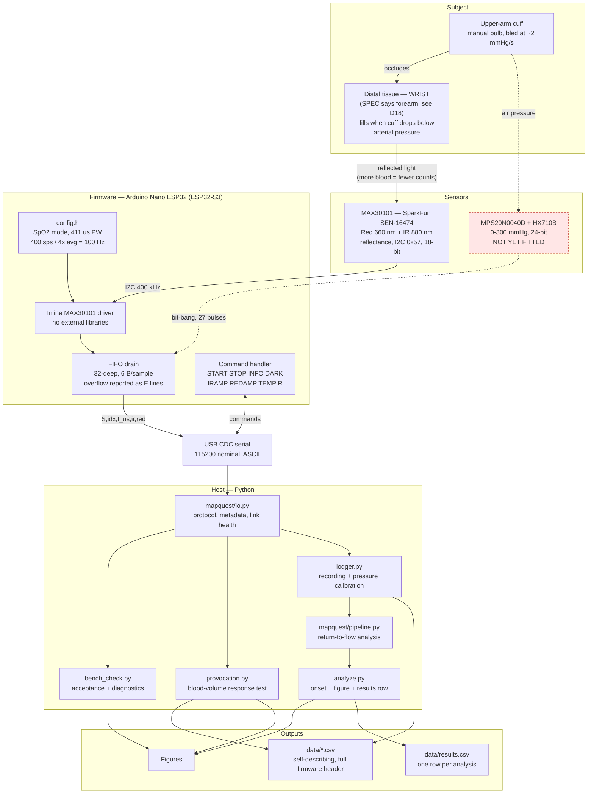
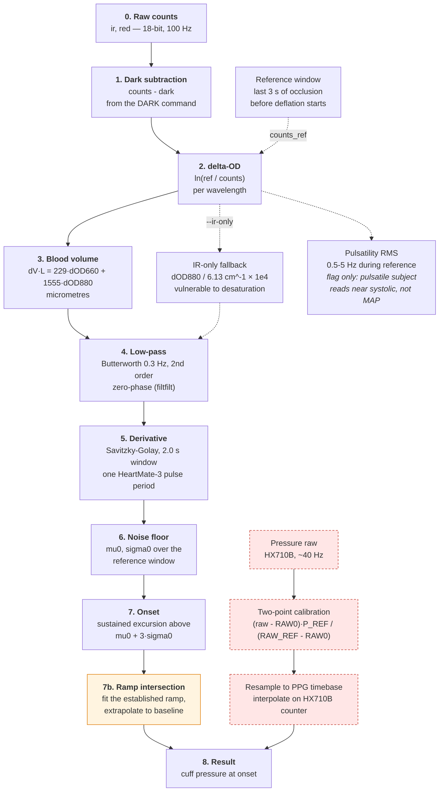
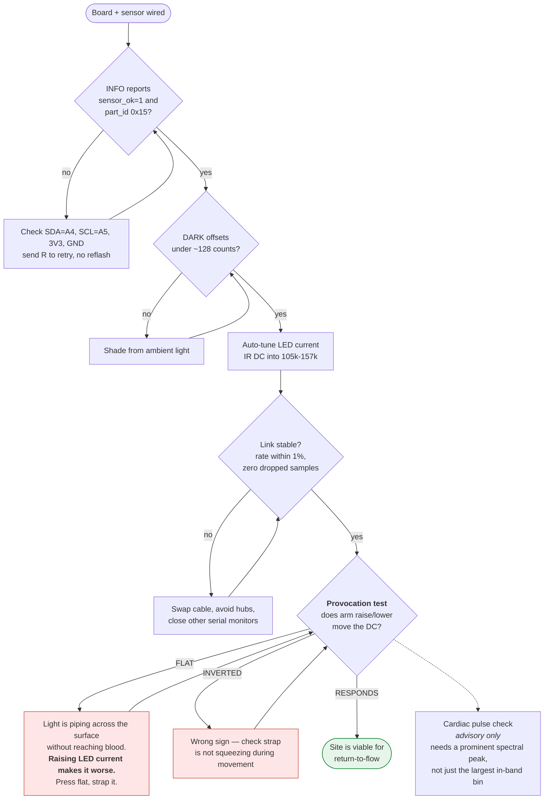
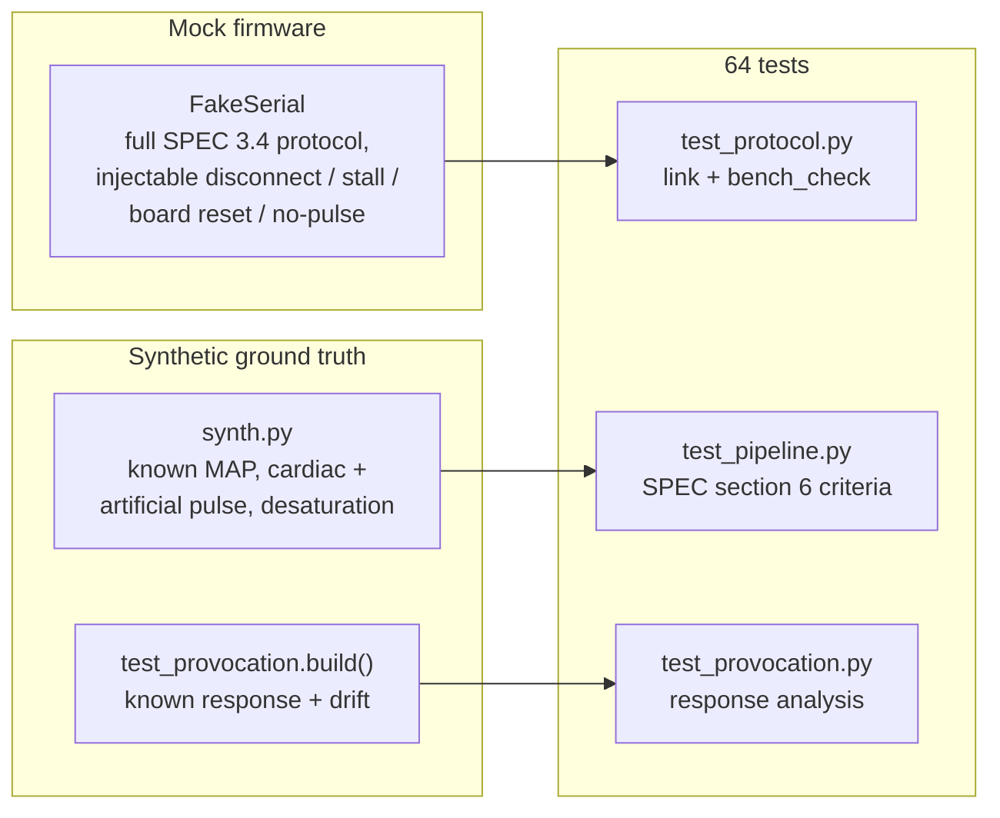

# MAPQuest — Architecture & Signal Pipeline

Living document. Updated as the system changes; see the status table at the bottom for what
is verified on hardware versus only on synthetic data. The reasoning behind each choice
lives in [`decisions.md`](decisions.md).

Last updated: 2026-10-06, after the first successful wrist provocation test.

---

## 1. End-to-end system

---

## 2. Return-to-flow signal pipeline

The measurement detects **slow venous filling**, not the cardiac pulse. The pulse is roughly
an order of magnitude smaller and is treated only as a quality flag.

**Orange** = deliberate deviation from SPEC §5.1. The spec's threshold-crossing onset reads
~2.6 mmHg high, because the 0.3 Hz zero-phase filter and the 2 s Savitzky–Golay window are
both symmetric kernels and smear the ramp corner backwards in time. `--onset-method
intersect` fits the established ramp and extrapolates back, landing within ±0.2 mmHg.

**Red dashed** = not yet built or not yet fitted.

---

## 3. Diagnostic path — what we run before trusting a recording

Every SPEC §3.5 acceptance criterion can pass with the photodiode staring at a wall, so the
gates below exist to catch that.

---

## 4. Validation layer

---

## 5. Status

| Layer | State | Evidence |
|---|---|---|
| Firmware — PPG | **working on hardware** | 100 Hz, zero dropped samples over 60 s, part id 0x15 |
| Firmware — pressure | written, never run | compiles under `PRESSURE_ENABLED=1` only |
| Serial protocol | **working** | real captures; plus mock-firmware tests |
| Link failure handling | tested on mock only | injected disconnect / stall / reset |
| Provocation test | **working on hardware** | wrist, z=37.8 up / 19.2 down, correct signs |
| Analysis pipeline | synthetic only | ±0.2 mmHg on synthetic ground truth |
| Pressure calibration | never run | no HX710B |
| Bench trials | not started | — |

### Open issues

Tracked as O1–O3 in [`decisions.md`](decisions.md).

| Issue | Impact |
|---|---|
| Red channel drifts ~90x more than IR (up to −1 %/s) | contaminates ΔV·L; dominates the onset noise floor |
| Onset noise floor measured at **~7.7 µm/s** (best rest period) | `synth.py` defaults to a 3 µm/s filling ramp, i.e. below the real threshold — the synthetic tests are optimistic |
| Baseline did not recover after the arm-down phase | ABA correction for "down" is an underestimate |
| Cardiac rate unstable between analysis settings (54 vs 158 bpm) | pulse readout not yet trustworthy; advisory only |
| No HX710B | onset *time* only; no pressure, so no MAP |
